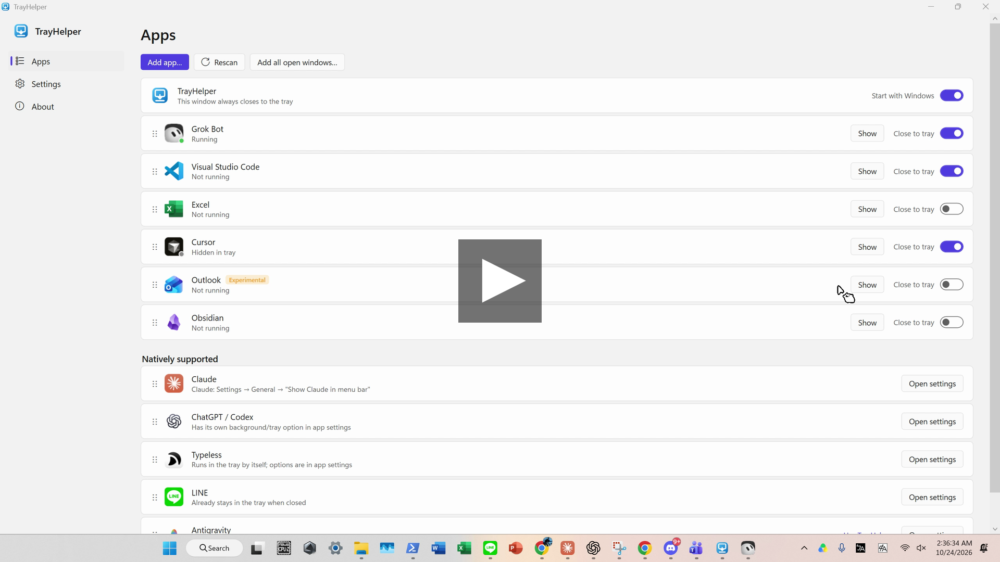

# TrayHelper

**Close the window, keep the app.** · [繁體中文](README.zh-TW.md)

TrayHelper is a small Windows 10/11 tray utility. For apps that quit when you press X (or Alt+F4), it hides the window into the notification area instead, so the app keeps running in the background. Click its tray icon to bring it back.

Unofficial, MIT-licensed, per-user (no admin).

[](docs/demo/tray-helper-demo.mp4)

▶ [Watch the demo (MP4, with subtitles)](docs/demo/tray-helper-demo.mp4) · 73 s, English narration with English + 繁體中文 subtitles ([en.srt](docs/demo/en.srt), [zh-TW.srt](docs/demo/zh-TW.srt))

## Features
- **Close to tray** for any app: X button, Alt+F4, and optionally Ctrl+Q / Ctrl+W.
- **Multi-window apps work like macOS**: closing one of several windows really closes it; only the last one goes to the tray. When several windows are hidden, the tray menu lists each one to restore on its own, plus **Restore all**.
- **One tray icon per managed app**: left-click to show or hide, right-click for a menu, middle-click to quit the app.
- **Send any window to the tray** with a shortcut (default **Ctrl+Alt+Down**). Its icon disappears once the window is back.
- **Show all hidden apps** with one shortcut (default **Ctrl+Alt+Up**). Both shortcuts are set with a click-and-press recorder in Settings.
- **Store / UWP apps** (Calculator, Photos…) are hidden on a separate hidden desktop, so there is no blank frame or taskbar ghost. Their tray icon is the app's own Store logo.
- **Crash-safe**: hidden windows are written to `hidden.txt`. After a TrayHelper crash or restart they're re-adopted, and **Exit always brings every window back**.
- **Fails safe**: if a window can't be hidden, the close goes through normally.
- **Smart main-window matching** by process, class and title. Splash screens and helper windows are ignored.
- **Auto-detects supported apps** (Grok Bot, VS Code, Cursor, Windsurf, Obsidian, Notion, Thunderbird, Outlook…). Apps that already have their own close-to-tray option (Claude, ChatGPT/Codex, Spotify, LINE, Typeless, LM Studio) are listed as *Natively supported* with an **Open settings** shortcut.
- **Native tray detection**: when a managed app turns out to own a tray icon, Settings offers **Use built-in**, which retires TrayHelper's toggle for that app. There is no popup.
- **Self-healing launch paths**: blank or stale paths, including Store paths that change with every package update, are fixed automatically from the running app.
- **Live config**: hand edits to `tray-helper.ini` apply immediately.
- **Updates** from GitHub Releases: Auto, Notify (default) or Off. Each download is SHA-256 verified, and the previous exe is kept as a rollback.

## Install
1. Download `TrayHelper-Setup.exe` from Releases and run it. It installs to `%LOCALAPPDATA%\TrayHelper`, adds itself to startup and the Start menu, and keeps your settings when upgrading.
2. Uninstall from **Settings → Apps → Installed apps**, or run `Uninstall.exe --uninstall` in the install folder. Hidden windows are restored first.

Setup switches: `--silent`, `--dir <path>`, `--no-run-key`, `--no-start`, `--uninstall`.

## Use
| Where | Action |
|---|---|
| TrayHelper icon | Left-click: settings · Right-click: quick panel |
| App's tray icon | Left-click: show/hide · Right-click: menu · Middle-click: quit the app |
| Anywhere | **Ctrl+Alt+Down** send the active window to the tray · **Ctrl+Alt+Up** show all hidden apps |

Add apps in **Settings → Apps**. Use **Add app…** for one app, or **Add all open windows…** to add several at once.

## Config (`tray-helper.ini`, next to the exe)
```ini
[General]
HotkeyRestoreAll=Ctrl+Alt+Up
HotkeySendToTray=Ctrl+Alt+Down
UwpVirtualDesktop=true        ; Store apps go to a hidden desktop
Updates=notify                ; auto | notify | off
UpdateRepo=stantheman0128/tray-helper

[App:My App]
Enabled=true
ExePath=C:\Path\MyApp.exe     ; or shell:AppsFolder\<AUMID> for Store apps; filled in automatically when blank
ProcessName=MyApp             ; "a|b" = either process
WindowClass=                  ; blank = any
WindowTitle=*My App           ; "*x" contains, "x*" starts with, blank = any titled window
InterceptCtrlQ=false
InterceptCtrlW=false
Geometric=false               ; force caption-geometry X detection (custom title bars)
```

## FAQ
- **An app runs as administrator and nothing happens.** Windows blocks a normal app from hooking an elevated one. Run TrayHelper as admin too, or leave that app out.
- **The X button of an app with a custom title bar isn't caught.** TrayHelper falls back to the standard caption-button position automatically. If that still misses, set `Geometric=true` for the app.
- **Antivirus warning.** The exe isn't code-signed yet. `installer\sign.ps1` is ready for when there's a certificate.
- **Can a stray middle-click close Grok Bot?** No. Middle-click quit is disabled for Grok Bot.

## Build
On Windows, with no SDK needed (it uses the .NET Framework 4.x `csc`):
```powershell
powershell -ExecutionPolicy Bypass -File build.ps1          # dist\TrayHelper.exe + dist\TrayHelper-Setup.exe
powershell -ExecutionPolicy Bypass -File tests\run.ps1      # automated tests on an isolated --test instance
```
To publish a release from the box, run `tools/release.sh <version>`, which uploads the exe, setup and `.sha256` files.

Third-party: [VirtualDesktopAccessor](https://github.com/Ciantic/VirtualDesktopAccessor) (MIT), see THIRD-PARTY.md.
